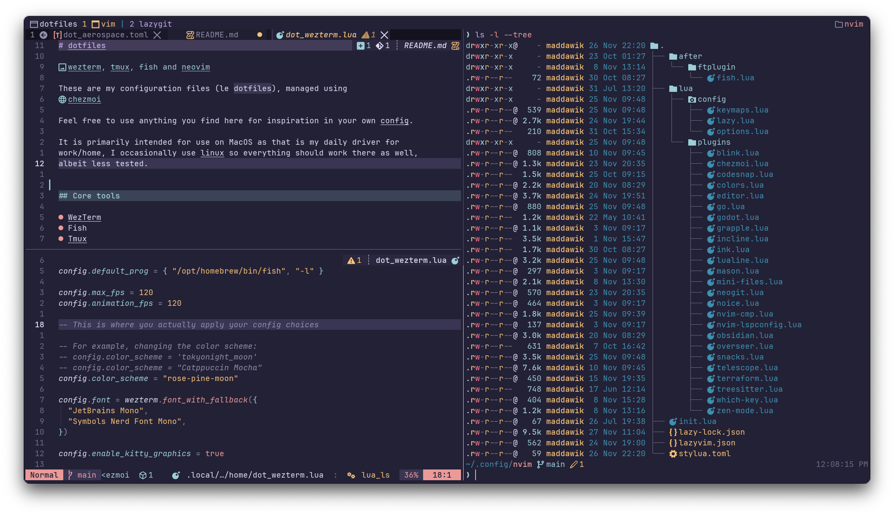

# ~



Managed with [chezmoi](https://www.chezmoi.io/)

Feel free to use anything you find here for inspiration in your own config.

It is primarily intended for use on MacOS as that is my daily driver for
work/home, I occasionally use linux so everything should work there as well,
albeit less tested.

## Core tools

- Ghostty
- Fish
- Tmux
- Neovim

## Install

> Note: These steps serve as reminder for me, not encouragement for you to
> blindly use my dotfiles as your own. But ya know, you do you boo.

On a fresh Mac, install the Xcode Command Line Tools first (chezmoi needs
`git` to clone, and macOS ships only a stub until these are installed):

```sh
xcode-select --install
```

With `chezmoi` already installed:

```sh
chezmoi init maddawik
```

Batteries included:

```sh
sh -c "$(curl -fsLS get.chezmoi.io)" -- init --apply maddawik
```

Transitory install (VMs/containers):

```sh
# Install dotfiles - then remove chezmoi, its source-dir and its config-dir
sh -c "$(curl -fsLS get.chezmoi.io)" -- init --one-shot maddawik
```

## Machine profiles

`chezmoi init` asks two questions on a host it doesn't recognise:

- **Work machine** — adds aws/k8s/terraform tooling, Slack, Teams, Zoom, Pritunl
- **Personal machine** — adds Discord, Plex, OBS

Both can be yes. Known hostnames are pre-answered in `.chezmoi.toml.tmpl`;
re-run `chezmoi init` to change an answer. Containers, codespaces and
non-interactive runs are treated as ephemeral: no GUI apps, no launch agents.

## New machine checklist

The first apply runs over https on purpose: the ssh URL rewrite in
`.gitconfig` only switches on once `~/.ssh/id_ed25519` exists, and that key
comes from 1Password. So the order is:

1. `xcode-select --install`, then the one-liner above. It installs Homebrew,
   packages (including the 1Password app and CLI) and macOS defaults.
2. Open 1Password, sign in to the personal account, and turn on
   Settings → Developer → "Integrate with 1Password CLI".
3. `chezmoi apply` again. It reads the GitHub key from 1Password into `~/.ssh`.
4. `chezmoi apply` once more. The gitconfig now rewrites GitHub to ssh.

`chezmoi apply` handles packages, macOS defaults (keyboard, trackpad, Dock,
Finder, disabled Mission Control / Spotlight shortcuts), Caps Lock → Control,
login items and background services. A few things still need a human:

- Raycast: sign in and confirm hotkey is `cmd+space` (Spotlight's is disabled)
- 1Password: sign in, enable CLI integration
- Ghostty / AeroSpace / Shottr / BetterDisplay / Raycast: grant Accessibility
  and Screen Recording when prompted
- Ghostty, Fish and Neovim: fisher plugins install on first fish launch
- GPG: import signing key `1208B7724BB2E9CA` into `~/.local/share/gnupg`
- SSH: copy keys and `~/.ssh/config` (work-specific, not in this repo)
- Energy: `sudo pmset -b displaysleep 2 && sudo pmset -c displaysleep 10`
- Software Update: turn on automatic macOS updates
- Default browser: pick Brave when it first launches
